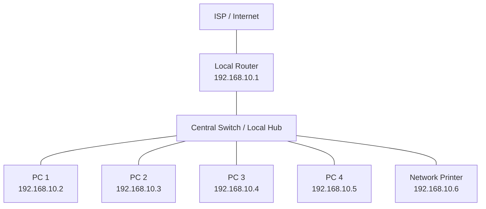

# CC 101 – Introduction to Computing

## "Know Your Network Settings": Exploring Windows 11 Network Configuration Tools

*Sorsogon State University – College of Information and Communications Technology, Bulan Campus*

- **Name** Fundano, Carl Nathaniel B. 
- **Block** BSCS 1-1 
- **Computer Unit Used (Desktop/Laptop, brand)** Lenovo – Ideapad Slim 3 
- **Date** October 18, 2026 

## I. Objectives

At the end of this activity, you should be able to:

- Locate network adapter information using Windows 11 Settings, the Control Panel, Command Prompt (CMD), and PowerShell.
- Use `ipconfig`, `getmac`, `hostname`, `ping`, `netstat`, `route print`, and `systeminfo` in CMD, and `Get-NetAdapter`, `Get-NetIPAddress`, and `Test-Connection` in PowerShell.
- Interpret a sample `ipconfig /all` output from a networked computer: identify its IP address, subnet mask, default gateway, and DNS servers, and classify the address as public or private.
- Relate each tool and finding to the layer of the OSI model where it works.
- Design a simple network and IP address plan for the computer laboratory.

## II. Materials Needed

- A computer running Windows 11 (a network or Internet connection is **not** required for this activity)
- This worksheet (printed copy, or the digital file to fill out and submit)
- Week 6 lecture notes, for reference on IP addresses, protocols, the OSI model, and network devices

## III. Background

A computer does not need to be connected to a network to have network settings. Every PC has one or more **network adapters** (NICs), each with a permanent **MAC address**, and Windows always runs the TCP/IP software, including the **loopback** address 127.0.0.1 (IPv4) and ::1 (IPv6) that the computer uses to talk to itself. Windows 11 lets you inspect these settings in four places: the **Settings** app, the classic **Control Panel**, **Command Prompt (CMD)**, and **PowerShell**. In this activity, you will explore all four on your own unit, observe how Windows behaves when no network is available, and then analyze a sample configuration taken from a computer that *is* connected to a network.

## IV. Procedure

**Reminder:** This is a *viewing* activity. Do not change, disable, or reset any network setting. Close every dialog with **Cancel**. Record values exactly as Windows shows them.

### Part A – Windows 11 Settings

1. Press **Windows + I** to open Settings, then click **Network & internet**. Write down the connection status shown at the top of the page (for example, "Not connected").
2. Click **Advanced network settings**. Under **Network adapters**, note every adapter listed (for example, Ethernet, Wi-Fi, Bluetooth Network Connection) and whether each one is enabled or disconnected.
3. Scroll down and click **Hardware and connection properties**. For each adapter, record its **Name**, **Description**, **Physical address (MAC)**, and **Status** in **Table 1**.

### Part B – Control Panel (Network Connections)

4. Press **Windows + R**, type `ncpa.cpl`, and press **Enter**. This opens the classic **Network Connections** window. A red X on an icon means the adapter has no network connection.
5. Right-click your **Ethernet** adapter and choose **Properties**. List the items checked under "This connection uses the following items" in **Table 2**.
6. Select **Internet Protocol Version 4 (TCP/IPv4)** and click **Properties**. Record whether the computer is set to **Obtain an IP address automatically** (DHCP) or **Use the following IP address** (static), and the same for DNS. Click **Cancel**, then **Cancel** again. Do not change anything.

### Part C – Command Prompt (CMD)

7. Press the **Windows key**, type `cmd`, and press **Enter**. Run each command below, one at a time, and record the results in **Table 3**.

   ```
   hostname
   getmac /v
   ipconfig /all
   ```

   *Tip: For a disconnected adapter, `ipconfig /all` shows "Media disconnected" and no IPv4 address, but it still shows the Description and Physical Address.*

8. Test the computer's own TCP/IP software using the loopback address. Record whether you got replies and the time. For `ping localhost`, note the address that replied.

   ```
   ping 127.0.0.1
   ping localhost
   ```

9. Now observe what happens when there is no network. Record the **exact** message each command displays.

   ```
   ping 8.8.8.8
   nslookup google.com
   ```

10. View the ports your computer is listening on and its routing table. In Table 3, record three LISTENING local addresses with their port numbers, and the Netmask shown for the Network Destination 127.0.0.0.

    ```
    netstat -an | findstr LISTENING
    route print -4
    ```

11. Run the command below. It may take a few seconds. Scroll to **Network Card(s)** and record how many network cards are installed and the status of each.

    ```
    systeminfo
    ```

### Part D – PowerShell

12. Right-click the **Start** button and choose **Terminal** (or press the **Windows key**, type `PowerShell`, and press **Enter**). Run each command below and record the results in **Table 4**.

    ```powershell
    Get-NetAdapter
    Get-NetIPAddress -AddressFamily IPv4 | Format-Table InterfaceAlias, IPAddress, PrefixLength
    Test-Connection 127.0.0.1 -Count 4
    Get-NetTCPConnection -State Listen | Select-Object -First 5 LocalAddress, LocalPort
    ```

    *Tip: PowerShell commands follow a Verb-Noun pattern (Get-NetAdapter = "get the network adapters"). Compare each result with the matching CMD command from Part C.*

### Part E – Analyze a Networked Computer

13. The output below was taken from a laboratory computer that **is** connected to a network. Study it, then complete **Table 5**.

**Sample Output 1. `ipconfig /all` (excerpt) from a networked PC**

```
Host Name . . . . . . . . . . . . : CICT-LAB-PC07
Ethernet adapter Ethernet:
   Description . . . . . . . . . . : Realtek PCIe GbE Family Controller
   Physical Address. . . . . . . . : 3C-52-82-A1-7F-09
   DHCP Enabled. . . . . . . . . . : Yes
   Link-local IPv6 Address . . . . : fe80::8c2d:4a1f:93b2:61e5%12(Preferred)
   IPv4 Address. . . . . . . . . . : 192.168.10.37(Preferred)
   Subnet Mask . . . . . . . . . . : 255.255.255.0
   Lease Obtained. . . . . . . . . : Wednesday, October 14, 2026 8:02:15 AM
   Lease Expires . . . . . . . . . : Thursday, October 15, 2026 8:02:15 AM
   Default Gateway . . . . . . . . : 192.168.10.1
   DHCP Server . . . . . . . . . . : 192.168.10.1
   DNS Servers . . . . . . . . . . : 192.168.10.1, 8.8.8.8
```

### Part F – Design a Network for Our Laboratory

14. Our laboratory does not yet have a network. Draw a simple **star topology** network for it. Include at least **four PCs**, one **switch**, one **router** (default gateway), one **printer**, and the **ISP / Internet**. Use lines to show connections.
15. Assign each device a private IPv4 address from the network **192.168.10.0/24**, using **192.168.10.1** for the router. Label each device in your drawing and complete the **IP Address Plan** (Table 6).

### Part G – Optional / Bonus

16. In CMD, run `type C:\Windows\System32\drivers\etc\hosts` to *view* (not edit) the hosts file. In one or two sentences, explain what this file is for and how it relates to DNS.

## V. Data and Findings

### Table 1. Network Adapters in Settings (Part A)

Connection status shown on the Network & internet page: *(left blank in the original)*

| Adapter Name | Description | Physical Address (MAC) | Status |
|---|---|---|---|
| Local Area Connection* 1 | Microsoft Wi-Fi Direct Virtual Adapter | 3a:9b:73:9d:c9:2b | Not Operational |
| Local Area Connection* 2 | Microsoft Wi-Fi Direct Virtual Adapter #2 | 3a:9b:73:9d:d9:3b | Not Operational |
| Wi-Fi | MediaTek Wi-Fi 6 MT7920 Wireless LAN Card | 38:9b:73:9d:e9:0b | Operational |
| Ethernet | ASIX AX88772C USB 2.0 to Fast Ethernet Adapter | 00:00:10:02:95:59 | Not Present |
| Bluetooth Network Connection | Bluetooth Device (Personal Area Network) | 38:9b:73:9d:e9:0b | Not Present |

### Table 2. Adapter Properties (Part B)

| Items Checked Under "This connection uses the following items" | Item Checked |
|---|---|
| Client for Microsoft Networks | Checked |
| File and Printer Sharing for Microsoft Networks | Checked |
| QoS Packet Scheduler | Checked |
| Internet Protocol Version 4 (TCP/IPv4) | Checked |
| Microsoft LLDP Protocol Driver | Checked |
| Internet Protocol Version 6 (TCP/IPv6) | Checked |
| Link-Layer Topology Discovery Responder | Checked |
| Link-Layer Topology Discovery Mapper I/O Driver | Checked |

| TCP/IPv4 Setting | Automatic or Static? |
|---|---|
| IP address | Automatic |
| DNS server address | Automatic |

### Table 3. Command Prompt Results (Part C)

| Command / Item | Your Findings | OSI Layer |
|---|---|---|
| `hostname` | LAPTOP-83BU72QR | Application Layer (Layer 7) |
| `getmac /v`: MAC address and Transport Name | Wi-Fi MediaTek Wi-Fi 38-9B-73-9D-E9-0B `\Device\Tcpip_{AD58063C-EB78-4490-A1C67E0A8293EAC7}` | Data Link Layer (Layer 2) |
| `ipconfig /all`: Media State of Ethernet | Media Disconnected | — |
| `ipconfig /all`: DHCP Enabled | Yes | — |
| `ping 127.0.0.1`: replies and time | Reply from 127.0.0.1: bytes=32 time<1ms TTL=128 | Network Layer (Layer 3) |
| `ping localhost`: address that replied | Reply from ::1: time<1ms | — |
| `ping 8.8.8.8`: exact message | Reply from 8.8.8.8: bytes=32 time=24ms TTL=115 | Network Layer (Layer 3) |
| `nslookup google.com`: exact message | Server: csp1.zte.com.cn<br>Address: fe80::1 | Application Layer (Layer 7) |
| `netstat -an`: three LISTENING addresses:ports | TCP 0.0.0.0:135 0.0.0.0:0 LISTENING<br>TCP 0.0.0.0:445 0.0.0.0:0 LISTENING<br>TCP 0.0.0.0:5040 0.0.0.0:0 LISTENING | Transport Layer (Layer 4) |
| `route print -4`: Netmask for 127.0.0.0 | 255.0.0.0 | — |
| `systeminfo`: number of NICs and status | 1 NIC(s) Installed.<br>MediaTek Wi-Fi 6 MT7920 Wireless LAN Card<br>Connection Name: Wi-Fi<br>DHCP Enabled: Yes | — |

### Table 4. PowerShell Results (Part D)

| Command | What It Showed | Matches CMD? (Y/N) |
|---|---|---|
| `Get-NetAdapter`: Name, Status, MacAddress, LinkSpeed | Name: Wi-Fi<br>Status: 14 Up<br>MacAddress: 38-9B-73-9D... | Y |
| `Get-NetIPAddress`: IPv4 addresses and PrefixLength | Wi-Fi: 192.168.1.6<br>PrefixLength: 24 | Y |
| `Test-Connection 127.0.0.1`: result | LAPTOP-83B... 127.0.0.1 192.168.1.6 fe80::d097:7420:dcf7:6dde%14 32 0 | Y |
| `Get-NetTCPConnection -State Listen`: two LocalAddress:LocalPort pairs | `::` 49669<br>`::` 49668 | Y |

### Table 5. Sample Output Analysis (Part E)

| Question | Your Answer |
|---|---|
| IPv4 address of PC07 | 192.168.10.37 |
| Subnet mask (and its /prefix) | 255.255.255.0 |
| Default gateway, and what device it usually is | 192.168.10.1 (Router) |
| DNS servers | 192.168.10.1 and 8.8.8.8 |
| Was the address assigned by DHCP or set manually? How do you know? | DHCP, because DHCP is enabled |
| Public or private? Which RFC 1918 range? | **Private**: Class C range (**192.168.0.0 – 192.168.255.255**) |
| IPv4 address of PC07 in binary (four octets) | 11000000.10101000.00001010.00100101 |
| MAC address, and the OSI layer where it is used | 3C-52-82-A1-7F-09, Data Link Layer (Layer 2) |
| How long is the DHCP lease? | 24 hours |
| If the DHCP server failed, what kind of address would PC07 assign itself? | A **Link-Local IPv4 Address** in the range 169.254.0.1 – 169.254.255.254. |

### Figure 1. Proposed Laboratory Network Diagram (Part F)

*(The original is a hand-drawn star topology; redrawn here as a Mermaid diagram.)*



### Table 6. IP Address Plan (Part F)

| Device | IPv4 Address | Subnet Mask | Default Gateway |
|---|---|---|---|
| Router (gateway) | 192.168.10.1 | 255.255.255.0 | — |
| PC 1 | 192.168.10.2 | 255.255.255.0 | 192.168.10.1 |
| PC 2 | 192.168.10.3 | 255.255.255.0 | 192.168.10.1 |
| PC 3 | 192.168.10.4 | 255.255.255.0 | 192.168.10.1 |
| PC 4 | 192.168.10.5 | 255.255.255.0 | 192.168.10.1 |
| Printer | 192.168.10.6 | 255.255.255.0 | 192.168.10.1 |

### Part G Notes (Optional / Bonus)

*(Left blank in the original.)*

## VI. Realization (Reflection)

*In two to four sentences each, answer the following in your own words.*

**1. Even without a network connection, what network information did your computer still have? Why do you think it still has it?**

Even without an internet connection, I could still see my MAC address, adapter names, computer hostname, and loopback IP (127.0.0.1). My computer keeps these because they are stored directly in my local hardware and operating system, requiring no internet to function.

**2. Compare Settings, Control Panel, CMD, and PowerShell. Which tool did you find most useful for viewing network information, and why?**

I found Command Prompt (CMD) to be the most useful tool during this activity. It allowed me to instantly view complete technical details with a single command instead of clicking through multiple menus.

**3. What did the messages from `ping 8.8.8.8` and `nslookup google.com` tell you? How would you use messages like these when troubleshooting a real network?**

ping told me my computer could successfully reach the internet, and nslookup showed my network could turn website names into IP addresses.

**4. Why should you be careful about sharing your MAC address, IP address, or `ipconfig /all` screenshots online? Relate your answer to data privacy.**

I need to be careful sharing my MAC and IP addresses because they reveal my unique hardware identity and network setup. Exposing this personal data online makes me vulnerable to cyberattacks.

## VII. Scoring Guide

| Criteria | Description | Points |
|---|---|---|
| Completeness | All tables (1–6) and required fields are filled out. | 25 |
| Accuracy | Recorded values match what the tools show and are consistent across Settings, CMD, and PowerShell; sample analysis, binary conversion, and OSI layers are correct. | 30 |
| Network Design | Diagram shows a star topology with PCs, switch, router, printer, and ISP; IP plan uses valid, non-duplicate addresses in 192.168.10.0/24. | 15 |
| Realization / Reflection | Answers are thoughtful, based on the student's own results, and well written. | 20 |
| Neatness & Timeliness | Worksheet is legible/well-formatted and submitted on time. | 10 |
| **Total** | | **100** |
